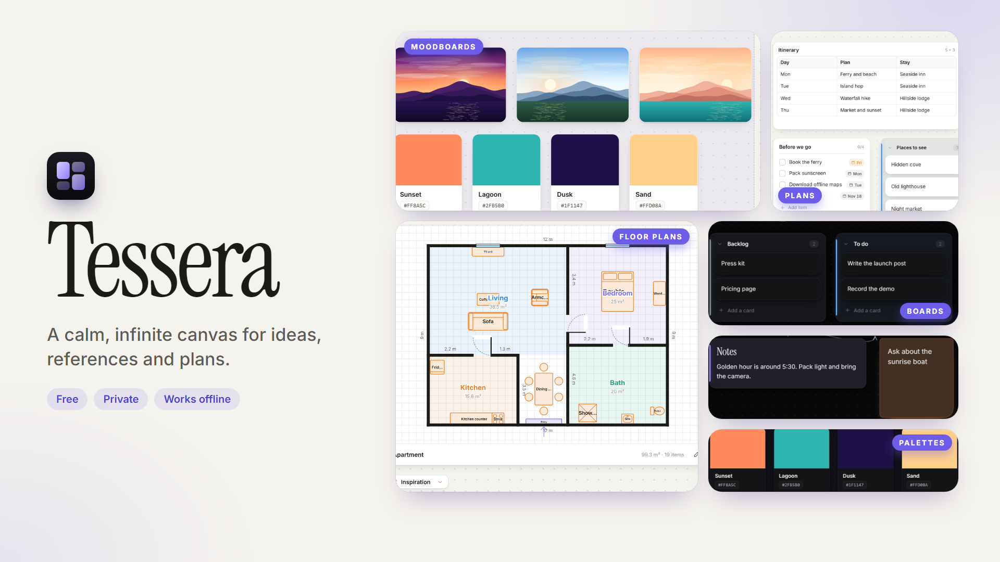
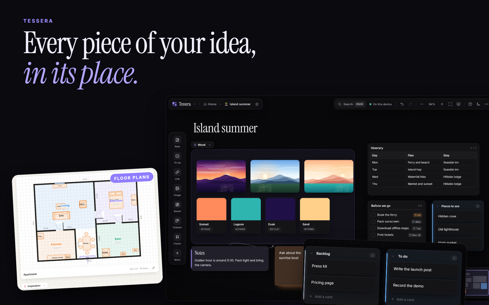

# Tessera

**A calm, infinite canvas for ideas, references and plans. Free, private and works offline.**

## About

Tessera is a place to gather notes, pictures, to-dos, maps and plans on one endless canvas and move them around until they make sense. Use it for moodboards, storyboards, trip plans, study notes, floor plans, project boards and anything else you would pin to a wall.

There is no account and no server. Your boards are saved on your device, and Tessera keeps working without an internet connection.

*The boards in these pictures are made-up samples.*

**[Try it: direkjames.github.io/Tessera](https://direkjames.github.io/Tessera/)**

## Features

**Cards for everything**
- Notes with bold, italic, headings, lists, colors, highlights, fonts, emoji and alignment
- To-do lists with due dates and a Due soon overview
- Images with cropping and captions, a fullscreen gallery, color extraction and web image clipping
- Sticky notes, headings, links, tables, color swatches and font cards
- YouTube and Vimeo videos, files with PDF previews and voice memos
- Highlighted code blocks, live clock and date cards, before and after comparisons
- Map cards with pins and offline snapshots, and to-scale **floor plans** with ready-made layouts, curved walls and table seats
- Shapes, lines and symbols for diagrams and flowcharts
- Shot list and storyboard cards, with CSV export

**Organizing**
- Frames, columns (collapsible), nested boards, grouping and box select
- Arrows between cards that route around other cards, with curves and labels
- Snapping, alignment guides, align, distribute and tidy, plus locking
- Tags with filtering, board icons and covers, pinned and recent boards, and archived boards
- A minimap, canvas backgrounds and smooth zoom
- **81 searchable templates** for creatives, video, students, teachers, healthcare, developers, events and everyday life, plus templates you save yourself

**Drawing**
- An **illustration studio** with pressure-sensitive brushes, a stabilizer, layers, blend modes, alpha lock, fill, lasso and transform. It works best with a pen tablet or stylus.

**Working your way**
- Kanban mode, focus mode and presentation mode, where frames become slides
- Global search and a command palette (Ctrl K), and a built-in guide and FAQ (press ?)
- 22 light and dark themes, including soft patterned ones like Paper grain, Sakura, Starry night and Blueprint, with 12 accent colors and a custom picker
- Your own heading font, optional subtle sounds and a customizable dock
- Undo and redo, copy and paste, and moving cards between boards

**Saving, sharing and backup**
- Autosave, version history for every board, and a 30-day trash
- Export a backup, or turn on automatic backup to a folder (Chrome and Edge on a computer)
- Optional sync between computers through a Google Drive, OneDrive or Dropbox folder
- Export to PNG, PDF and Markdown, share a board as a file, or share a **view-only link** that needs no upload
- Print layouts, and privacy locks for boards

## Getting started

1. Open [direkjames.github.io/Tessera](https://direkjames.github.io/Tessera/).
2. Choose **Start from scratch** or **Start from a template**, or explore the sample board.
3. Double-click the canvas to write a note, or drag cards in from the dock. Drop images straight onto the board.
4. Press Ctrl K to search, and **Ctrl S** to export a backup.
5. To use it like an app, press **Install** in Chrome or Edge, or choose *Add to Home screen* on Android.

**Your boards live on your device.** Clearing site data, uninstalling the app or using a private window erases them, so export a backup now and then or turn on automatic backup.

**Sharing a board:** open **Export & share** (Ctrl E). A *board file* includes everything, and the other person adds it with **Import a board**. A *share link* gives a read-only copy to pan, zoom and present. The board is packed into the part of the link after the `#`, which browsers never send to a server, so images, files and voice memos show as placeholders, and very large boards may not fit.

Board locks are a privacy lock inside the app, not encryption. Backups still contain the board's contents.

## Requirements

- A modern web browser. Chrome and Edge are best, since the automatic backup folder and sync need them on a computer.
- An internet connection the first time, so the app can load. After that it works offline.
- A few optional features go online: map cards load maps and place search from OpenStreetMap, font cards and heading fonts load from Google Fonts, and link cards show site icons from Google. Everything else stays on your device.

## Built with

- HTML, CSS and JavaScript in a single page, with no build step
- IndexedDB for saving and a service worker for offline use
- Inter and Instrument Serif typefaces
- [OpenStreetMap](https://www.openstreetmap.org/copyright) for map cards

Want to host it yourself? See [Developing Tessera](docs/DEVELOPING.md).

## Status

Shipped.

## Credits / License

Made by [direkjames](https://github.com/direkjames). Map data © OpenStreetMap contributors. See [LICENSE](LICENSE).
